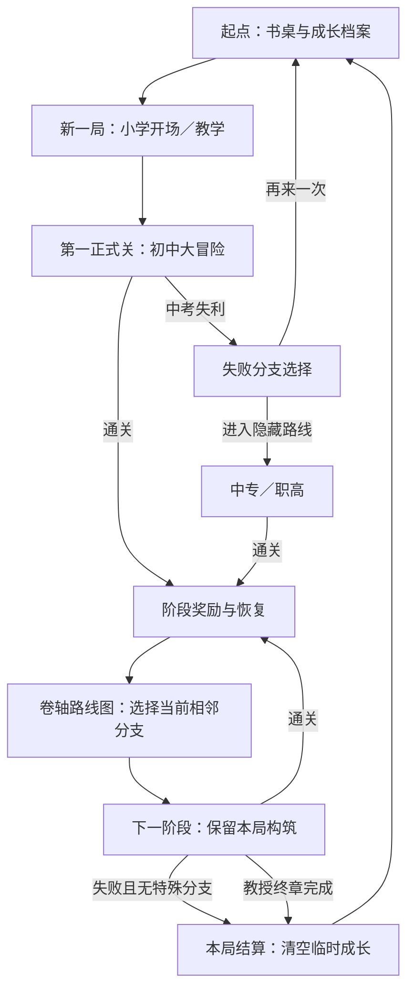
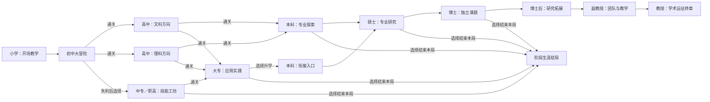

# 科研大冒险 · 设计与开发计划 V1

日期：2026-10-27  
创建人：ScarfQian  
状态：设计提案，尚未实现  
对应版本：0.0.1 · 修改编号 20261027-001

## 1. 游戏想让玩家体验什么

玩家从小学启程，把考试、方向选择、课题研究和学术生涯变成一次可以反复尝试的冒险。每关形成一次短而完整的挑战，每个阶段得到的卡片会改变下一关的打法。失败既可能结束本局，也可能打开另一条路线；不同教育路径应提供不同构筑机会。

核心乐趣是“这一次怎么成长”：靠稳定防守、刷题连击、动手实验、调查协作或风险较高的灵感爆发，逐步形成一套具有个人特点的能力。成长路线决定遭遇和选项，卡片决定战斗表现。

### 1.1 用户已确定与本方案暂定的边界

| 项目 | 用户已确定 | V1 暂定实现方向 |
| --- | --- | --- |
| 项目 | 独立目录、独立 GitHub 仓库，先写计划 | 仓库名 research-adventure；0.0.1 为设计版本 |
| 起步 | 从小学起步；示例第一关为初中 | 小学为开场／教学，初中为第一正式关 |
| 战斗 | 肉鸽，每阶段一个关卡 | 俯视走位、自动攻击、有限波次、阶段首领 |
| 卡片 | 各阶段有特色，后期有人才与项目题材 | 竖版三选一；攻击变化、方法协同、项目／荣誉三类 |
| 地图 | 参考卷轴地图，结算后选路线 | 固定成长路线图结合本局可选节点，不在战场找出口 |
| 新一局 | 从第一关开始 | 局外保留图鉴与路线资格，清空局内构筑 |
| 解锁 | 通关才解锁后续；之后仍须再次过前置 | 永久资格与本局相邻可达条件同时满足才可选择 |
| 失败 | 初中失利可重来或进入职教隐藏关 | 初中阶段失败先给路线选择，确认重来才结束旧局 |

本文中的波数、数值、卡名、条件、估算工时均是候选设计；不是已有代码或体验结论。现实教育路径、岗位与项目制度只提供题材，游戏内连线不表示现实必须遵循的职业路径。

## 2. 一局怎样推进

通关地图不是可以随意传送的世界地图。它展示整条成长路径，但只有本次结算的相邻节点可以进入。高阶段节点可在地图上显示名称和图鉴进度，同时明确显示“需本局完成某阶段”。

从阶段奖励页进入地图后，必须先选中节点、查看路线说明，再点击“前往”。只浏览节点不消耗资源，也不结束当前选择。进入下一阶段后，本局不返回上一关刷奖励。

### 2.1 每关内部循环

1. 查看本关主题、首领和可能出现的阶段卡，进入战场。
2. 自动攻击，玩家控制走位和闪避；获取关内资源。
3. 普通波提供补给；精英波或成长节点打开竖版三选一。
4. 击败阶段首领，先结算本关，再提供阶段奖励、恢复和后续路线。
5. 整局失败、主动结束或完成教授终章时结算，不把同一阶段奖励发放两次。

首个初中切片暂按 **10 波**设计：第 5 波精英，第 10 波“中考试炼”首领。候选选卡节点为第 2、5、8 波与首领结算。单关目标约 3—5 分钟，完整生涯目标约 30—45 分钟；这些是节奏目标，需要实际体验后调整，不机械照搬鹈鹕的 30 波配置。后续阶段可用课题、答辩等目标替换部分常规波，但先共用清晰的战斗骨架。

## 3. 成长路线与阶段内容

### 3.1 路线图

本科衔接入口和普通本科共用一个阶段地图，通过入口事件、已有技能与卡池权重区分，不重复制作一套本科。高中两个方向共用基础场景骨架，敌人组合、主题事件和卡池不同。硕士专业也采用同阶段不同主题，避免一开始制作大量地图。

V1 把博士后、副教授、教授串成可理解的游戏主线。直博、工作后返校、海外支线、讲师／研究员等路径先不展开；它们不是用户本轮必须实现的路线。

### 3.2 各阶段设计表

| 阶段／稳定 ID | 场景与目标 | 敌人／首领题材 | 特色卡候选 | 后续 |
| --- | --- | --- | --- | --- |
| 小学 primary | 操场、书桌、作业小径；认识移动与选卡 | 涂鸦团、粗心橡皮；无强制失败首领 | 好奇心、认真审题、同桌互助 | 初中 |
| 初中 junior | 课程迷宫与考场广场；建立基础构筑 | 拖延团、错题虫、偏科影；中考试炼 | 错题本、举一反三、课间冲刺 | 高中文／理；失败可转职教 |
| 高中文科 senior-humanities | 文史书庭与论证长廊 | 断章幽灵、时间沙漏；综合论述卷 | 引经据典、论点展开、材料串联 | 本科／大专 |
| 高中理科 senior-science | 公式庭院与实验走廊 | 符号混淆体、计算旋涡；综合推演卷 | 数形结合、公式连锁、实验验证 | 本科／大专 |
| 中专／职高 vocational | 技能工坊、实训场 | 故障齿轮、材料乱流；实操挑战台 | 熟能生巧、工具改装、协作装配 | 大专／阶段结局 |
| 大专 college | 工程训练与项目街区 | 需求变更团、调试迷雾；交付挑战 | 快速原型、现场排障、实践迭代 | 本科衔接／阶段结局 |
| 本科 undergraduate | 校园、图书馆、实验室 | 文献碎片、截止风暴；毕业设计守卫 | 课程组合、文献阅读、跨学科选修 | 硕士／阶段结局 |
| 硕士 master | 按专业变化的研究地图 | 噪声团、样本迷雾、解释偏差；学位答辩 | 专业方法卡、组会反馈、研究复现 | 博士／阶段结局 |
| 博士 doctorate | 长周期课题与原创问题 | 负结果浪潮、审稿回声、实验瓶颈；独立研究试炼 | 独立问题、长期积累、方法突破 | 博士后／阶段结局 |
| 博士后 postdoc | 合作实验室与项目群岛 | 资源争夺影、并行任务团；项目评审试炼 | 博新计划、协作网络、青年课题 | 副教授 |
| 副教授 associate | 教学研究双线与团队营地 | 时间分身、协调迷阵；团队建设试炼 | 国自然／国社科项目、优青题材、育人相长 | 教授 |
| 教授 professor | 学科远征与复杂问题 | 多目标风暴、学科壁垒；综合研究终章 | 杰青／长江题材、学术共同体、战略课题 | 本局通关结局 |

以上敌人是困难的拟人化，不把学生、教师或同行当作需要击杀的对象。实训路线重工具与部署，文科重信息传播与协同，理科重推演与连锁，均可形成有竞争力的构筑。

### 3.3 专业选择

本科先通过课程卡接触方向，硕士入场时正式选择专业主题。专业不是永久角色职业：每一局可重新选择，前期卡片影响协同，不应把一局早期选择变成无法补救的死路。

| 专业主题 | 核心玩法 | 主动表现由自动攻击触发 | 后期项目路线 |
| --- | --- | --- | --- |
| 数学与物理 | 轨迹、穿透、规律叠加 | 几何弹道、周期共振 | 自然科学题材 |
| 工程与计算 | 装置、自动化、部署 | 小型工具台、协作机、并行弹流 | 自然科学题材 |
| 生命与医学 | 持续恢复、扩散、样本协同 | 培养环、抑制场、治愈脉冲 | 自然科学题材；不提供现实医疗建议 |
| 经济与管理 | 资源效率、组合与调度 | 调度阵、资源交换、连携标记 | 按课题标签选择自然／社科题材 |
| 人文与社会 | 论证、调查、群体协同 | 引文连锁、调查标记、共识波 | 社会科学题材 |

首轮专业开发只实现“工程与计算”“人文与社会”两条差异明显的方向，验证构筑是否有区别，再扩展其余主题。完整路线表保留所有目标，但不一次性铺满专业内容。

## 4. 解锁与失败：最重要的规则

### 4.1 两类进度必须分开

| 进度 | 保存什么 | 能做什么 | 不能做什么 |
| --- | --- | --- | --- |
| 永久成长档案 | 已通关阶段、已发现路线、已解锁卡片图鉴、外观、纪录 | 使满足本局前置条件的节点显示可选；扩充合法阶段卡池 | 直接跳过初中／高中；把上局伤害和项目带入新局 |
| 本局远征 | 当前阶段、通过的节点、路线选择、卡片、资源、装备、课题结果 | 判断本次结算能选择哪一站；跨阶段延续构筑 | 在回起点后继续沿用旧局属性；选择没有相邻连线的节点 |

**可进入下一站 = 当前处于允许选路的结算 + 本局刚完成相应前置或失败分支 + 存在相应连线 + 已满足路线解锁条件。**

首次通关前置阶段就解锁其正常后继，并在本次结算立即开放选择，不必故意让玩家多打一遍才能首次进入。初中失败时，在失败选择页发现并解锁职业教育路线，但该路线未来仍须在本局触发同类失败分支才可进入；初中通关后的直接职教选择暂不开放。

### 4.2 用户示例的完整结果

| 情况 | 正确行为 |
| --- | --- |
| 首次通关初中 | 本次即可选高中文科或理科；相应路线加入档案 |
| 首次通关高中 | 本次即可选本科或大专；两个后继均解锁，不要求各打一遍高中才显示 |
| 上一局已通关高中，当前回到起点 | 仍从初中开始，本科／大专只能在图上查看 |
| 新一局再次通关高中 | 本次可以重新选本科或大专，不受上一局选择束缚 |
| 初中失败并选“再来一次” | 旧局结束，临时卡片／货币清零，从初中重开；不是直接重打高中 |
| 初中失败并选“技能也能开路” | 阶段标为失利，进入同一局的职教路线；不误记为整局结束 |
| 职教通关进入大专 | 保留本局构筑；大专后可经本科衔接进入硕士 |
| 高中后查看已发现博士节点 | 可查看节点介绍，无法点击进入；提示缺少本局前置 |
| 战场中打开成长地图 | 只读查看，不允许选关或重置战场 |
| 已完成教授终章后回起点 | 保存纪录和图鉴，清空本局构筑；下次仍从初中开始 |

### 4.3 失败不应成为重复刷资源的入口

初中失败触发一次选择：重新开始或转入职教。转入职教时暂定保留已有卡片与装备、恢复到最大体力的 70%、扣除未消费灵感的 25%，不发放初中通关奖励；不改变解锁判定。该补给是为了让零体力的失败分支可继续游玩，数值需体验调整。

其余阶段首版失败结束本局，不加入反复付费复活。职教失败不能再次回到相同失败页领取补给。主动返回起点视为结束本局，会明确提示临时成长清空；因浏览器恢复而继续未结束的局不算“新开局”。

结算文案区分“阶段失利”“生涯结束”“阶段结局”“远征通关”。中考失利是用户指定的提示，下一句提供有行动空间的选择，例如“这一次没有升入高中。重新挑战，或去技能工坊寻找另一条路。”

## 5. 战斗与卡片构筑

### 5.1 基础动作

候选采用俯视移动和自动寻找目标，键盘 WASD／方向键与触屏摇杆等价；玩家主动操作集中在走位、闪避和选卡。没有手动攻击箭头，也不要求持续按攻击按钮。视觉瞄准反馈使用短暂的目标标记与武器动画。

开局用“铅笔”作为单发基础攻击、“课本”作为基础防护。后续从笔记、尺规、工具、书卷、仪器等成长，不直接移植鹈鹕武器名称。正式数值依赖首关体验，不在设计阶段虚构通关能力。

### 5.2 卡片应能看见玩法变化

| 卡片类型 | 作用 | 示例 |
| --- | --- | --- |
| 攻击变化 | 新轨迹、新数量、新攻击实体 | 举一反三让铅笔分裂；引经据典产生引文连锁；工具改装部署装置 |
| 方法与协同 | 把命中、移动、恢复或资源事件串联 | 错题本记录未命中的方向，下一轮追加纠错攻击；实验验证让重复命中形成脉冲 |
| 稳定强化 | 改善伤害、生命、速度、范围 | 专注练习、健康作息、课间冲刺 |
| 阶段机会 | 改变下一段路线或奖励倾向 | 跨学科选修、组会反馈、合作课题 |
| 科研项目 | 接取本局目标，完成获得阶段资源或能力 | 国自然／国社科题材项目 |
| 人才荣誉 | 有条件出现的稀有构筑方向 | 博新、优青、杰青、长江题材卡 |

普通奖励三选一，精英奖励提高稀有候选权重，阶段首领奖励至少一张当前阶段的特色卡。候选池只包含当前可用且未满级的卡；有合适攻击变化卡时，优先提供至少一张，避免连续只出现加百分比的卡。若合适卡不足三张，展示实际可用数量和补给选项，不出现空卡或重复选择同一卡。

同名普通卡可升级，首版暂定上限 3 级；升级说明显示“现在 → 选择后”。攻击变化要有明确触发频率和派生次数上限，避免无限连锁。具体数值在各卡实际实现时登记。

### 5.3 第一组卡片候选

| 稳定 ID | 名称／阶段 | 玩法提案 | 视觉标志 |
| --- | --- | --- | --- |
| card-curiosity | 好奇心／小学 | 接近未知补给后短时扩大自动索敌范围 | 带星光的放大镜 |
| card-careful-reading | 认真审题／小学 | 稳定命中同一目标后提高下一次攻击效果 | 勾画重点的课本 |
| card-error-notebook | 错题本／初中 | 每完成一轮攻击积累笔记，满层追加纠错飞页 | 红色订正笔与翻页 |
| card-generalization | 举一反三／初中 | 基础投射物增加侧向分裂 | 一支铅笔分成三束 |
| card-recess-sprint | 课间冲刺／初中 | 闪避后留下短时加速笔迹 | 运动鞋与粉笔轨迹 |
| card-citation-chain | 引经据典／高中文科 | 命中标记在附近敌人间传播一次引文伤害 | 书页连接成链 |
| card-geometric-proof | 数形结合／高中理科 | 连续攻击形成三角轨迹，包围区域触发一次脉冲 | 尺规与几何线 |
| card-tool-mod | 工具改装／职教 | 周期部署短时工具装置，继承部分基础伤害 | 扳手与小工作台 |
| card-rapid-prototype | 快速原型／大专 | 装置部署变快，持续时间缩短；偏重频繁调度 | 折叠工作箱 |
| card-cross-course | 跨学科选修／本科 | 下一次奖励增加一个可协同的跨方向候选 | 两色课程表 |
| card-reproducibility | 研究复现／硕士 | 完成稳定连续命中条件后复制一次方法效果 | 两组一致的实验图标 |
| card-original-question | 独立问题／博士 | 选定一个攻击核心专精，提高它的效果并限制另一类协同 | 带问号的课题手稿 |

这里只登记设计 ID 与主题，不生成临时图再当成正式素材。早期通用卡进入高阶段后继续生效，并可与专业卡协同；已经获得的卡不会因为离开原阶段而自动消失。

### 5.4 后期科研项目与人才荣誉

这些题材并非同一种荣誉。游戏把科研资助设计为“任务与资源”，把人才荣誉设计为“稀有构筑方向”，避免所有名称都变成同一种伤害加成。下表“出现阶段／条件”完全是游戏提案，不描述现实资格、申报年龄、名额或兼容规定。

| 卡片题材 | 游戏类别／出现范围 | 游戏内触发提案 | 效果与取舍 |
| --- | --- | --- | --- |
| 博新计划 | 人才支持／博士后阶段 | 完成博士课题，带有独立研究标签 | 获得启动补给和短期研究加速；本阶段需完成一个限时目标 |
| 国自然项目 | 科研项目／博士后及以后 | 当前课题匹配自然科学标签；经管方向按选题进入 | 提供经费与方法增强；占一个在研项目槽，完成目标才结题 |
| 国社科项目 | 科研项目／博士后及以后 | 当前课题匹配人文社科标签 | 强化调查、论证与协作；与自然项目有不同目标和奖励 |
| 优青 | 人才荣誉／副教授阶段起 | 本局完成若干独立目标，候选阈值待定 | 选择一个专业核心升级，并缩减其他方向的加成 |
| 杰青 | 人才荣誉／教授阶段 | 本局形成成熟专业构筑并完成高难课题 | 强化领域核心与团队协同；与优青归入同一游戏专精槽，作为升级替换 |
| 长江 | 人才荣誉／教授阶段 | 完成教学与研究双目标 | 偏重团队、育人与协作，与单体爆发方向形成另一种选择 |

首版候选限制为 1 个在研项目槽、1 个核心荣誉槽。限槽是游戏平衡规则，不暗示现实制度互斥。人才卡只对本局生效，永久图鉴保留发现记录；不能刷到后每局自动携带。

项目未完成只失去约定的结题奖励，不采用“突然扣空全部资源”的惩罚。高阶段卡不能因永久图鉴解锁而出现在初中卡池。正式制作卡面时用清晰的类别标记区分“项目”“人才支持”“荣誉”，不使用现实机关标识。

## 6. 地图、卡片与固定资产的美术方案

### 6.1 卷轴成长地图

参考用户截图的横向卷轴、手绘地标和路径连接。地图从左到右由书桌、校园、工坊、大学、研究所延伸到学术山峰；教育分支采用上下岔路。保留完整地图的探索感，当前可选范围应立即可辨。

| 节点状态 | 表现 | 操作 |
| --- | --- | --- |
| 本局当前位置 | 角色旗标、阶段名、完成／失利印记 | 查看本关结算 |
| 本次可选 | 明亮轮廓、连线高亮、“可前往”标签 | 点击预览，再确认进入 |
| 永久已发现但本局不可达 | 正常图标、较浅路径、前置提示 | 只读介绍 |
| 尚未发现 | 地标剪影或问号 | 显示发现线索，不暴露全部奖励 |
| 已选择并离开的节点 | 本局脚印与路线着色 | 查看，不返回刷取 |

选中节点时侧栏显示主题、路线风格、卡池倾向和本局适用条件。手机上地图可以横向拖动；选择确认区固定在下方，避免误把拖动当进入。使用图标、文字和边框共同区分状态，不只依赖颜色。

### 6.2 竖版卡片

桌面并排三张竖卡，上方为名称与稀有度，中间大图，下方简明效果与升级前后，底部为选择按钮或整卡确认区域。触屏保持竖卡比例，窄屏横向滑动并标出 1／3、2／3、3／3；键盘支持 1／2／3，焦点清晰可见。选卡暂停战斗。

卡面图标使用固定资产编号。稀有度、专业方向、效果类别采用独立标记，避免只凭颜色猜测。稀有卡增加纹饰与动画，但文本优先清楚；不复制参考游戏的现成卡面。

### 6.3 角色与素材先建档

主角暂定为可换装的人类学生，跨阶段保留头身特征，以书包、校服、毕业服、实验外套和学术配件体现成长。人物身份与最终画风尚未定稿，本轮不生成正式人物图。动物主角若以后采用，应作为明确美术方向调整。

首个可玩切片只制作：1 名主角、3 类普通困难怪、1 类精英、1 个初中首领、1 张初中地图、1 个职教入口地标、3 个教学道具及 8—12 个卡面图标。NPC、完整大学城和全套高级荣誉图先不制作。

资产卡至少登记：稳定 ID、名称、类别、修订号、轮廓与配色、尺寸／碰撞范围、动作挂点、可用动作、关联卡片或阶段、来源、预览。人物、地图节点、卡面和战场共用同一对象定义；数值变化不自动重画造型。需要优化时修改源资产并递增修订号。

## 7. 资源、存档和结算

### 7.1 资源尽量少

| 资源 | 用途 | 跨阶段 | 新一局 |
| --- | --- | --- | --- |
| 精力 | 战斗生存值 | 保留并按阶段补给恢复 | 重置 |
| 灵感 | 从关内挑战获得，消费于方法／装备调整 | 保留 | 清零 |
| 经费 | 后期科研项目专用，管理项目与装置 | 在同一局保留 | 清零 |
| 成长档案 | 路线发现、图鉴、纪录与外观 | 永久保存 | 保留，但不直接增加攻击属性 |

早期原型只实现精力和灵感，经费到科研阶段再加入。前期不堆叠金币、学分、经验、荣誉点等重复货币。选卡由明确波次／挑战节点触发，不再另造一套经验货币。

### 7.2 存档设计草案

独立键拟为 `research-adventure-save-v1`，不读取或迁移两个鹈鹕项目的存档。

- 永久档案：版本、路线发现、阶段首次完成、卡片发现、外观、纪录、设置。
- 进行中的局：本局编号、当前阶段、已走路线、卡片等级、专业、资源、已结算阶段及最近安全节点。
- 结算记录：本次已发放的阶段／整局奖励；刷新或重开界面不重复发放。

建议只在阶段入场及阶段结算后建立续局节点，不首发保存每颗子弹的位置。刷新恢复“进行中的局”与“回起点开新局”是不同操作；选择开新局或确认回起点会结束旧局。战斗中刷新究竟重打本关还是放弃本局，在 P5 实现续局时确定并向玩家明确说明，不能默认声称已经有完整断点恢复。

### 7.3 结算页

显示走过的路线、关键卡片、专业、阶段最高进度、失利／结局原因及本局新发现。重开按钮说明“从初中重新开始，保留成长档案”。中考失利的分支页应先展示两条路线选择，不提前把构筑清空或写成整局结束。

## 8. 技术范围与实现顺序

计划沿用轻量网页技术：原生 HTML、CSS、JavaScript 与本地素材。优先能直接打开体验，不先引入服务器、账号、联机或构建框架。本轮只写文档，不创建空游戏入口或伪可玩按钮。

实现时把阶段连线、阶段卡池、卡片效果和资产引用作为清楚的数据表维护。核心逻辑分清：本局启动、波次推进、卡片结算、阶段结算、合法后继生成、进入下一阶段、整局结束。代码是否拆分文件，依据实际规模决定；不提前搭建通用游戏引擎。

可以在后续有需要时复用鹈鹕项目成熟的输入、自动攻击和 SVG 组装思路；复用前明确来源及差异，不整体复制旧存档、营地和波次规则，不修改旧项目来承载新游戏。

## 9. 分期开发排期

以下按有效开发日估算，不是日历承诺，也没有创建自动任务。当前只执行 P0。P1 以后起始日期等待用户要求开始开发；每期只把实际完成内容写入日志。试玩和游戏自动化检查当前不执行，相关验收项保留为待授权验证。

| 阶段 | 预计有效开发日 | 内容与交付 | 完成判定 |
| --- | --- | --- | --- |
| P0 项目与方案 | 本轮 | 独立目录、公开 GitHub 仓库、计划 V1、日志、交接、版本 0.0.1 | 本地文件与远端设计文档可读取；无游戏发布 |
| P1 初中最小可玩切片 | 第 1—4 日 | 小学开场、主角基础动作、初中 10 波、自动攻击、3 类怪与首领、竖卡、失败分支页、基础路线图 | 能表达完整初中胜／败流程；本科节点绝不能从起点进入；实际运行验收需后续允许 |
| P2 升学与分支 | 第 5—8 日 | 高中文／理、职教、大专、本科及衔接入口；不同卡池和本局相邻选路 | 一条高中路线和一条职教路线可抵达本科；重开仍从第一关；无重复领奖 |
| P3 专业与研究 | 第 9—13 日 | 硕士两个首发专业、博士、专业协同与研究主题首领 | 两专业具有可观察的攻击／资源差别；早期卡仍可协同 |
| P4 科研生涯 | 第 14—18 日 | 博士后、副教授、教授；项目槽、荣誉槽与六类指定题材卡 | 科研项目和人才荣誉的效果不同；高级卡不越阶段出现；教授结局可结算 |
| P5 存档与全程体验 | 第 19—23 日 | 稳定存档、续局规则、完整路线与卡片图鉴、卷轴地图完善、触屏布局 | 允许验证后覆盖重开／恢复、路线条件、临时清零、手机操作及完整生涯 |
| P6 平衡与首次可玩发布 | 第 24—28 日 | 调整难度曲线、卡池、节奏、提示、效果强度；准备版本与发布说明 | 已发现的关键问题修复；用户决定是否合并 main 并发布 Pages |

P1—P4 共用阶段框架和素材骨架，先形成可比较的玩法再扩内容。若 P1 的自动攻击、节奏或路线模型需要重做，优先修正并顺延后续，不按表格日期宣布完成。约 28 个有效开发日仅为范围估计，实际速度受用户反馈、素材制作和可执行验证范围影响。

### 9.1 第一批实施清单

| 顺序 | 工作 | 本批明确不展开 |
| --- | --- | --- |
| 1 | 固定主角与初中资产编号，给主角和卡片做小规模造型候选 | 全生涯人物与地图美术 |
| 2 | 形成初中战场、输入与自动攻击 | 所有专业武器 |
| 3 | 加入 10 波、首领、阶段成败与三选一 | 完整后期项目系统 |
| 4 | 接入初中通关／失败后路线图，严格判断本局前置 | 从起点选择高级关卡 |
| 5 | 保存最低限度永久路线档案，重开清空构筑 | 云存档、账号、联机 |
| 6 | 更新版本和日志，列出实际检查与待试玩项 | 未获指令的推送、合并或上线 |

## 10. 验收场景与日志工作计划

### 10.1 后续必须观察的行为

这些是未来实现的验收场景，不是已运行测试，也不要求本轮新建测试框架。

| 场景 | 要确认的结果 |
| --- | --- |
| 新档开始、旧档重开 | 都进入第一正式关；小学教学说明可跳过但不跳关 |
| 初中首次胜利 | 高中两个方向当次可选，奖励只记一次 |
| 初中第一次失利 | 出现“中考失利”和重开／职教选项，选择前构筑尚在 |
| 失败转职教后再次失败 | 结束该局，不能反复领取失败补给 |
| 已解锁本科后回起点 | 本科可查看但不可进入；再次过高中才可选本科／大专 |
| 大专到本科衔接 | 只进入合法衔接入口，保留本局构筑，不重复旧关奖励 |
| 卡片达到上限／候选不足 | 不提供无效升级，不出现空卡，补给替代说明清楚 |
| 获得攻击变化卡 | 战场中能看到轨迹或攻击实体变化，衍生效果不会无限递归 |
| 取得后期荣誉后重开 | 保留图鉴记录，初中不携带荣誉效果或抽取高级卡 |
| 阶段结算刷新／存储失败 | 不双发奖励；未保存时明确提示，不冒充保存成功 |
| 手机拖动地图与卡片 | 拖动不误触进入／选卡，文字可读，确认入口可达 |
| 通关教授 | 完整本局结算，返回起点后清空临时成长 |

### 10.2 日志维护方式

只维护已有的综合计划、开发日志、交接和版本文件，不为每个操作新建任务表。每批开发在 `docs/DEVELOPMENT.md` 追加：日期与修改编号、对应阶段、需求及原因、行为前后变化、关键文件／资产 ID、实际核对范围、尚未验证的实质问题、下一项工作。

`CHANGELOG.md` 面向玩家写行为变化；`version.json` 记录真实实现身份和发布状态；`docs/HANDOFF.md` 保持最新待办和接手边界。设计改动直接修订本计划并提升计划修订号，旧版本由项目版本历史保留。没有运行的浏览器、移动端或自动化检查一律写“未运行”，不以文件存在代替通关验证。

### 10.3 需要在制作时继续确定的设计

主角最终形象、单关节奏、职业教育失败补给数值、各卡上限与叠加、硕士首发专业命名，以及续局时战斗中刷新策略，均留在相应阶段确定。现有方案足以初始化项目并开始最小切片，无需现在逐项选择所有后期数值。

## 11. 本轮范围与参考

本轮交付为项目目录、GitHub 仓库与设计文档，不实现游戏、不生成正式资产、不配置 Pages，也不把设计版当作可玩版。

需求来源为用户在本对话 2026-10-27 提出的教育／科研阶段肉鸽设想，以及用户提供的卷轴选图截图。截图只作为布局参考，不复制上传到仓库。本文未引用现实升学规定或项目申报政策；未来若写入现实资格说明，必须另行核对当期官方来源。
